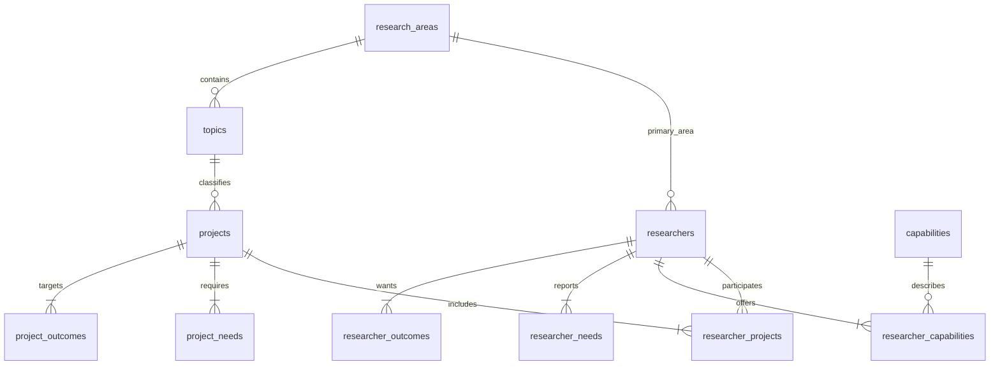

# Data model

The source of truth is `data/sustech_synthetic.sqlite`. People and projects have a many-to-many relationship through `researcher_projects`.

The diagram omits metadata and some foreign keys. The complete definitions are in [`schema.sql`](../schema.sql).

| Table | Purpose |
| --- | --- |
| `metadata` | Seed, provenance and synthetic-data notices |
| `research_areas` | The four sustainability themes |
| `topics` | 32 research topics, each linked to an area |
| `researchers` | Name, role, primary area and summary |
| `projects` | Title, summary, topic, approach, context, challenge and stage |
| `researcher_projects` | Unique person–project memberships and contributions |
| `capabilities` | Shared vocabulary of 53 expertise tags |
| `researcher_capabilities` | Expertise a person offers and fictional proficiency |
| `researcher_needs` | Personal gaps, categories and priorities |
| `researcher_outcomes` | Research, impact and development objectives |
| `project_needs` | Expertise, equipment, data, funding and partner needs |
| `project_outcomes` | Intended metrics, target values, units and time horizons |

Personal needs and outcomes reference a project that person participates in, using composite foreign keys. Expertise needs have a capability reference; resource needs intentionally have no capability ID.

`v_researcher_overview` and `v_project_overview` provide flat browsing views. `v_potential_collaborators` matches expertise gaps with proficiency 4–5 offers, excluding self-matches and existing collaborators. Its `cross_area` flag compares researchers' primary areas.

Proficiency is fictional: 1 introductory, 2 assisted, 3 independent practitioner, 4 advanced, 5 specialist. The generated offers use levels 3–5.

There are 250 people and 375 projects in each area. Exactly 200 people have each project count from one to five. The default seed produces 937 shared projects and 263 projects with teams spanning primary areas. These are generation choices, not estimates of a real institution.

Projects represent studies or work packages, not necessarily funded grants. A PhD researcher can therefore participate in several projects without leading a grant.

All targets are future aspirations. Percentages describe relative changes against hypothetical internal controls; actual baseline measurements are not supplied.

## Search implementation

Search builds documents from the normalized tables with SQL joins. Each document retains its owner, field and source ID. Terms are passed as parameters to escaped `LIKE` expressions; literal `%`, `_` and backslashes do not become search wildcards.

Each OR group requires all its terms somewhere in that record's searchable documents. The matching document IDs are grouped before joining back to people or projects, avoiding duplicate results. Names/titles are ordered ahead of description, expertise and project matches, followed by alphabetical order.

The response includes one real matching excerpt per displayed result. With an AND query, the excerpt may show only one term when the other terms occur in different fields. Pages contain at most 15 records.

The UI does not include the former SQL editor. SQL examples and the schema remain available as files for direct database exploration.

## Network

`GET /api/network` returns every researcher as a node and every distinct pair of people sharing a project as a link. A self-join on `researcher_projects` finds these pairs, with the lower researcher ID first to avoid duplicates. Each link carries its number of shared projects. A node's degree counts distinct collaborators, not memberships or projects.

The default dataset has 1,000 nodes and 2,237 links. Researchers without a collaborator remain visible. Canvas draws a deterministic layout grouped by primary area, with higher-degree nodes nearer each group's centre. Positions and distances do not imply similarity or relationship strength. These are existing project relationships in the fictional data; expertise-based suggestions are separate and appear in profiles.
